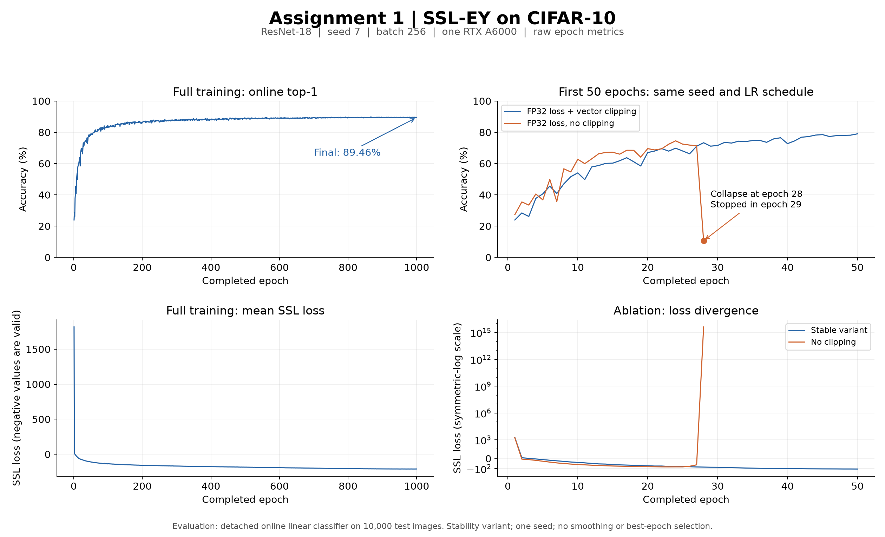

# SSL-EY CIFAR-10 experiment results

This report records a single-seed, full-budget **stability variant** implemented with stable-pretraining. It does not claim exact reproduction of the paper's numerical result.

## Protocol

ResNet-18 with CIFAR stem, 512 -> 2048 -> 2048 -> 2048 projector, batch 256, seed 7, one RTX A6000, 1000-epoch reference learning-rate schedule. All 50000 training images are available to the shuffled loader with `drop_last=True`; each epoch has 195 batches. Evaluation uses all 10000 test images with deterministic normalization and a detached online linear classifier trained alongside SSL. Supervised classifier gradients do not enter the encoder/projector. This matches the inspected author's pretraining evaluation pathway; it is not a separate frozen-encoder probe.

The stable run used FP32 loss arithmetic and joint norm-1 clipping of the one-dimensional parameters excluded from LARS adaptation. The comparison omitted only clipping (apart from name/revision metadata); both retained mixed-precision network execution. Configurations are in [server/](../server/README.md).

## Recorded results

| Run | Completed epochs | Framework steps | Final recorded top-1 | Top-5 | Status |
|---|---:|---:|---:|---:|---|
| Stable | 1000 | 195000 | 89.46% | 99.63% | Complete |
| FP32 loss, no clipping | 28 / planned 50 | 5460 at last epoch | 10.62% | 56.74% | Failed at step 5581 during epoch 29 |

The stable trajectory reached 79.03%, 84.12%, 86.55%, 88.60% and 89.46% at epochs 50, 100, 200, 500 and 1000. The last 100 epochs ranged from 89.38% to 89.70%. Reported primary scores use the final epoch, not a favorable checkpoint selected on test performance.

The ablation scored 71.36% at epoch 27, then 10.62% at epoch 28 with mean SSL loss about 4.22615e15. At the same epoch the stable run scored 73.32%. The failed comparison is stability evidence for this seed/environment, not a matched-duration accuracy comparison to epoch 1000 or proof of a general accuracy improvement.

## Numerical behavior and final-model verification

All 1000 stable epoch records were contiguous and finite, with zero recorded non-finite loss batches. AMP recorded 95 gradient-overflow skips: 13 in the first 50 epochs and 82 after resumption. Thus 195000 framework steps are not necessarily 195000 parameter updates. Final AMP scale was 32768 and mean SSL loss was -210.34388732910156.

After training, verification checked that the final checkpoint matched the recipe and step count, all model tensors were finite, strict model-state loading passed, and the exported backbone exactly matched the checkpoint. Inference on four real CIFAR-10 images produced finite embeddings, projections and logits with nonconstant embeddings. This small inference check establishes artifact integrity, not a substitute for the full-split accuracy measurement.

The ablation recorded 319 AMP skips before failure. The guard raised `FloatingPointError: Non-finite model state` for backbone/projector BatchNorm running statistics. Its zero invalid-batch counter does not imply a healthy model: the state check raised before that failing batch could be recorded.

## Runtime and provenance

The stable run began fresh for 50 epochs and resumed from the verified epoch-boundary checkpoint through epoch 1000 with optimizer, scheduler and scaler state. The first job's total runtime was 19m28s; the resumed job took 5h15m26s, so the latter alone is not the total from-scratch duration. The ablation started fresh and failed after 10m19s. Allocation time includes setup and verification overhead.

Recorded environment: Python 3.12.3, torch 2.8.0+cu126, torchvision 0.23.0+cu126, Lightning 2.6.6, single RTX A6000, 8 allocated CPUs and 32 GB host RAM. The author reference is [solo-learn commit 11eac929a3cfb8fe28cefa573ef87e08fcf1eb27](https://github.com/jameschapman19/solo-learn/tree/11eac929a3cfb8fe28cefa573ef87e08fcf1eb27). Pinned reference fixtures and their licenses accompany the automated tests.

The machine-readable [summary](ssley-cifar10.json) is derived from the recorded epoch histories, run status and final verification output. Full logs and checkpoints are retained outside the source contribution; no raw dataset or model weights are included here.

## Limits of the claim

The paper's Table 1 reports CIFAR-10 top-1 91.43%, 1.97 percentage points above this final score. Historical software, seeds and checkpoint selection are not completely recovered, and our stability modifications are explicit departures. Do not attribute the gap to unverified author practices or claim exact paper reproduction. This is one seed, one GPU, with no all-seed confidence interval or multi-GPU runtime validation.
